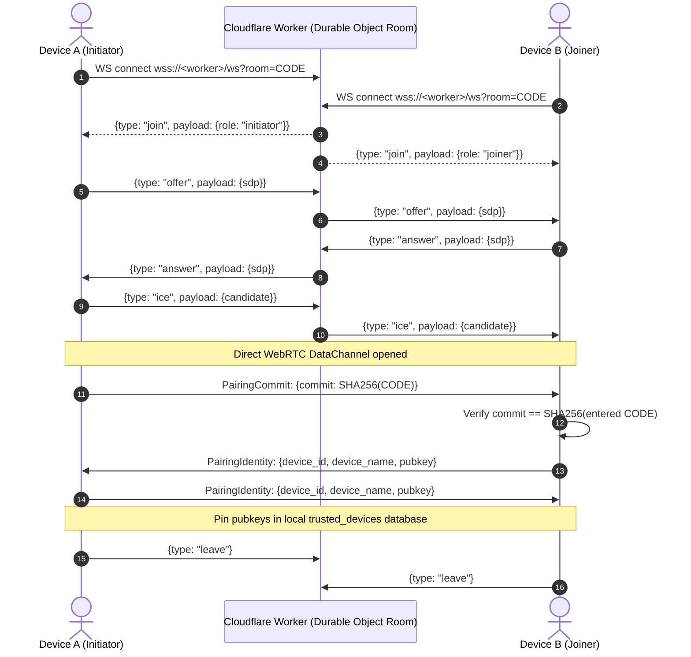

# FileProto Specification

## 1. Overview
FileProto is the unified application-layer protocol for the NAS Share ecosystem. It operates symmetrically across two transports:
1. **LAN Transport**: HTTP/1.1 REST-style endpoints over TCP (Default port: `8743`).
2. **WAN Transport**: Bidirectional WebRTC DataChannel using DTLS-encrypted frame streaming.

Every node acts as both a Server (serving shared folders) and a Client (browsing and transferring files).

---

## 2. Pairing & Identity

### 2.1 Identity
Each device generates an Ed25519 keypair on first run:
- `device_id`: Canonical UUIDv4 string.
- `device_name`: Human-readable name (hostname / model).
- `pubkey`: 32-byte Ed25519 public key hex string.

### 2.2 Pairing Code Format
- Alphabet: **Crockford Base32** (`ABCDEFGHJKMNPQRSTVWXYZ23456789`). Excludes ambiguous characters `I, L, O, U, 0, 1`.
- Format: `XXXX-XXXX` (8 characters, case-insensitive, dash optional in entry).
- Entropy: 40 bits of CSPRNG entropy.
- TTL: 5 minutes.
- Single-use: Burned immediately upon successful identity pinning.

### 2.3 Handshake Protocol


---

## 3. Protocol Operations

### 3.1 `list`
Lists entries inside a sandboxed folder path.
- **HTTP**: `GET /api/list?path=<relative_path>`
- **DataChannel**: `{"type":"list", "id":"<req_id>", "path":"<relative_path>"}`
- **Response**:
  ```json
  {
    "ok": true,
    "entries": [
      {
        "name": "document.pdf",
        "entry_type": "file",
        "size": 1048576,
        "mtime": 1728250000000,
        "hash": "optional_sha256"
      },
      {
        "name": "Photos",
        "entry_type": "dir",
        "size": 0,
        "mtime": 1728250000000
      }
    ]
  }
  ```

### 3.2 `stat`
Fetches metadata for a single path.
- **HTTP**: `GET /api/stat?path=<relative_path>`
- **DataChannel**: `{"type":"stat", "id":"<req_id>", "path":"<relative_path>"}`
- **Response**:
  ```json
  {
    "ok": true,
    "meta": {
      "name": "video.mp4",
      "entry_type": "file",
      "size": 524288000,
      "mtime": 1728250000000,
      "mime_type": "video/mp4"
    }
  }
  ```

### 3.3 `read` (Download & Streaming Seek)
Reads slice of a file at specified offset and length. Supports HTTP standard `Range: bytes=offset-end` and partial content `206 Partial Content`.
- **HTTP**: `GET /api/read?path=<relative_path>&offset=<bytes>&len=<bytes>`
  - Headers: `Range: bytes=<offset>-<offset+len-1>`
  - Responses: `200 OK` (full) or `206 Partial Content` (sliced)
  - Headers: `Content-Range: bytes <offset>-<offset+len-1>/<total_size>`, `Accept-Ranges: bytes`
- **DataChannel**:
  - Request: `{"type":"read", "id":"<req_id>", "path":"<path>", "offset":0, "len":65536}`
  - Binary framing chunks (16KB - 64KB per chunk).

### 3.4 `write` (Resumable Upload)
Writes chunk of data to the target path.
- **HTTP**: `POST /api/write?path=<relative_path>&offset=<bytes>&resume_id=<optional_uuid>`
  - Body: Binary bytes
- **Response**:
  ```json
  {
    "type": "write_ack",
    "id": "<req_id>",
    "ok": true,
    "bytes_written": 65536
  }
  ```

### 3.5 `thumb`
Retrieves JPEG preview thumbnail (200x200 max) for image/video.
- **HTTP**: `GET /api/thumb?path=<relative_path>`
- **Response**: `200 OK` with `Content-Type: image/jpeg` binary payload.

### 3.6 `sync_manifest`
Returns recursive catalog with SHA-256 digests for folder synchronization.
- **HTTP**: `GET /api/sync_manifest?root=<root_label>&recursive=true`
- **DataChannel**: `{"type":"sync_manifest", "id":"<req_id>", "root":"<root>", "recursive":true}`
- **Response**:
  ```json
  {
    "type": "sync_manifest_response",
    "id": "<req_id>",
    "ok": true,
    "entries": [
      {
        "path": "docs/report.pdf",
        "size": 40960,
        "mtime": 1728250000000,
        "sha256": "e3b0c44298fc1c149afbf4c8996fb92427ae41e4649b934ca495991b7852b855"
      }
    ]
  }
  ```

---

## 4. Conflict Resolution Strategy
When syncing two folders with concurrent modifications:
- Rule: **Keep-Both Strategy**.
- If remote modified time differs and file hashes differ, neither file is destroyed.
- The colliding incoming file is stored as:
  `<filename>.conflict-<device_id>-<timestamp>.<ext>`
- The event is logged in the sync activity log.

---

## 5. Security & Sandboxing
1. **Path-traversal Guard**:
   - Every path is stripped of leading slashes and drive letters.
   - Target path is resolved canonically (`canonicalize()`).
   - Prefix match check verifies that canonical path starts with one of the configured `shared_folders`.
   - Access outside configured shares immediately yields `{"ok":false, "code":"DENIED"}`.
2. **Access Control (ACL)**:
   - `READ`: Allows `list`, `stat`, `read`, `thumb`, `sync_manifest`.
   - `READWRITE`: Allows `write`, `delete`, and read operations.
3. **E2EE**:
   - Zero byte transfer occurs on Cloudflare Workers.
   - WAN transfers require DTLS v1.2 / v1.3 via WebRTC DataChannel.
